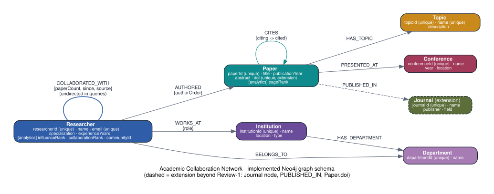
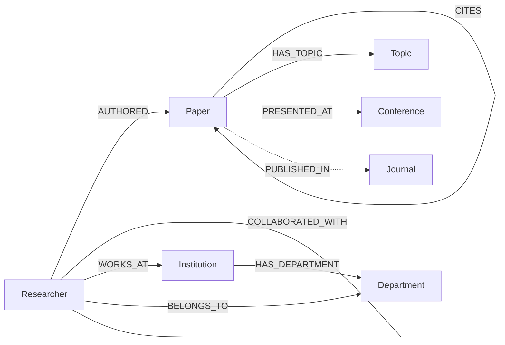

# Academic Collaboration Network

Database Systems Lab (BCSE302P), VIT: Kalpesh Warke (24BCE2109), Kartikey Mittal (24BKT0167). Faculty: Lydia Jane G.

This is a working graph database application. It stores researchers, papers, institutions, departments, topics, conferences and journals as nodes in **Neo4j**, and connects them with authorship, collaboration, affiliation, citation, topic and venue relationships. A FastAPI backend runs **parameterised Cypher** for CRUD, the ten planned queries, collaborator recommendations, PageRank, Louvain community detection and shortest paths. A React frontend makes all of it usable in the browser, including an interactive graph view.

> Neo4j is the only data store. Nothing is served from JSON files or in-memory mock data, and every number in the UI comes from a Cypher query at request time.

---

## Contents
1. [Problem statement](#1-problem-statement)
2. [Objectives](#2-objectives)
3. [Scope](#3-scope)
4. [Why Neo4j](#4-why-neo4j-and-not-a-relational-or-document-database)
5. [Requirements](#5-functional-and-non-functional-requirements)
6. [Graph schema](#6-graph-schema-node-labels-and-properties)
7. [Relationship types](#7-relationship-types-and-directions)
8. [Schema diagram](#8-schema-diagram)
9. [ER-to-NoSQL mapping](#9-er-to-nosql-mapping)
10. [Dataset](#10-dataset-design-and-counts)
11. [Cypher queries](#11-major-cypher-queries)
12. [Graph analytics](#12-graph-analytics-methodology)
13. [Collaborator recommendations](#13-collaborator-recommendation-methodology)
14. [Architecture](#14-architecture-and-modules)
15. [Installation and running](#15-installation-and-execution)
16. [Testing and benchmarks](#16-testing-and-benchmark-results)
17. [Design decisions and Review-1 inconsistencies](#17-design-decisions-and-review-1-inconsistencies)
18. [Limitations and future work](#18-limitations-and-future-enhancements)

The requirement traceability table is in [`docs/TRACEABILITY.md`](docs/TRACEABILITY.md), and the viva demo script is in [`docs/DEMO_CHECKLIST.md`](docs/DEMO_CHECKLIST.md).

---

## 1. Problem statement
Academic research involves interconnected entities such as researchers, papers, institutions and research topics. Managing and analysing relationships like collaboration, authorship and citation is complex in tabular storage because the important questions are multi-hop: who is two collaborations away from me, which papers transitively build on this one, and who should I work with next. This project represents those entities as nodes and their connections as first-class relationships in Neo4j, so those questions become short graph traversals.

## 2. Objectives
- Represent researchers, papers, institutions, departments, topics and conferences as graph nodes.
- Model authorship, collaboration, affiliation, citation, topic and venue relationships.
- Run graph queries and traversals to explore connections.
- Identify influential researchers and papers (PageRank) and research communities (Louvain).
- Recommend potential collaborators from shared topics, mutual collaborators and network proximity.
- Provide an interactive visualisation of the academic network.

## 3. Scope
- One Neo4j database with 152 nodes and 637 relationships of 7 labels and 9 relationship types. That covers the 6 labels and 8 relationship types from Review-1, plus the `Journal` / `PUBLISHED_IN` extension.
- Full CRUD for researchers, papers, institutions, departments, topics, conferences and journals.
- The 10 planned queries, a recommendation engine and 3 analytics features, each exposed through a REST endpoint and a UI screen.
- A local development deployment: Neo4j Desktop, Server or Docker, plus `uvicorn` and `vite`. Section 15 covers how to deploy against Aura.

## 4. Why Neo4j (and not a relational or document database)
| Need in this project | Relational (SQL) | Document (MongoDB) | Neo4j (graph) |
|---|---|---|---|
| "Collaborators of collaborators", 2–4 hops | One self-join per hop, and the cost grows with table size | Manual application-side joins or `$graphLookup` | `(r)-[:COLLABORATED_WITH*2..3]-(c)`. Index-free adjacency means each hop follows pointers. |
| Shortest path between two researchers | Recursive CTE, awkward to bound and to return the path | Not natural | Built-in `shortestPath()` |
| Citation trees up and down | Recursive CTEs in both directions | Not natural | `-[:CITES*1..3]->` and `<-[:CITES*1..3]-` |
| PageRank and community detection | Export the data to another tool | Export the data to another tool | Graph Data Science plugin, or NetworkX on the projected graph with results written back |
| Schema evolution (we added `Journal`) | Migration plus a new join table | Easy | Add a label and a relationship type. Existing queries are unaffected. |

The value of this domain is in the relationships, so storing them as first-class, typed, directed edges with properties (`authorOrder`, `paperCount`, `since`) is the natural model.

## 5. Functional and non-functional requirements
**Functional (Review-1 §6.1)**
- CRUD for author profiles (`Researcher`), papers, institutions, topics and journals. Departments and conferences get CRUD too.
- Collaboration discovery: common co-authors, indirect collaborators, and shortest paths (degrees of separation).
- Citation network analysis: upstream (papers cited by a paper) and downstream (papers citing a paper), each up to 3 levels.
- Recommendation system: suggest collaborators from shared research topics and mutual co-authors.

**Non-functional (Review-1 §6.2)**
- Performance: sub-second traversals up to 4 degrees of separation. `database/benchmark.py` measures this (section 16).
- Scalability: at least 100 nodes and 300 relationships without latency degradation. The dataset has 152 and 637.
- Data integrity: uniqueness constraints on researcher IDs, paper IDs, paper **DOIs**, institution IDs and the IDs of every other label.
- Also implemented: `.env` configuration, server-side validation (Pydantic), one JSON error format, request logging with timings, driver lifecycle management, guarded destructive operations, and a development/production switch.

## 6. Graph schema: node labels and properties
| Label | Properties (the **bold** one is the unique key) | Notes |
|---|---|---|
| `Researcher` | **researcherId**, name, email (unique), specialization, experienceYears | Analytics write back `influenceRank`, `collaborationRank` and `communityId` |
| `Paper` | **paperId**, title, publicationYear, abstract, doi (unique) | `doi` is an extension required by the NFR. PageRank writes `pageRank`. |
| `Institution` | **institutionId**, name, location, type | |
| `Department` | **departmentId**, name | IDs are institution-specific, e.g. `VIT-SCOPE` |
| `Topic` | **topicId**, name (unique), description | |
| `Conference` | **conferenceId**, name, year, location | |
| `Journal` *(extension)* | **journalId**, name, publisher, field | Added because the FR asks for journal CRUD |

Constraints and indexes are defined in [`backend/database/schema.cypher`](backend/database/schema.cypher):
- 10 uniqueness constraints: all 7 IDs, plus `Researcher.email`, `Paper.doi` and `Topic.name`.
- 7 range indexes: researcher name and specialization, paper year and title, institution name, conference year, journal name.
- 1 full-text index on `Paper(title, abstract)`, which powers the search box.

Existence (`IS NOT NULL`) constraints need Neo4j Enterprise, so required fields are enforced by the API's validation layer instead.

## 7. Relationship types and directions
| Type | Direction | Properties | Meaning |
|---|---|---|---|
| `AUTHORED` | Researcher → Paper | authorOrder | The researcher authored the paper |
| `COLLABORATED_WITH` | Researcher → Researcher | paperCount, since, source | The two researchers collaborated. Treated as undirected (see below). |
| `WORKS_AT` | Researcher → Institution | role | Affiliation |
| `BELONGS_TO` | Researcher → Department | | Department membership |
| `CITES` | Paper → Paper | | The **citing** paper points to the **cited** paper |
| `HAS_TOPIC` | Paper → Topic | | Research area |
| `PRESENTED_AT` | Paper → Conference | | Venue |
| `HAS_DEPARTMENT` | Institution → Department | | Department belongs to the institution |
| `PUBLISHED_IN` *(extension)* | Paper → Journal | | Journal venue |

**`COLLABORATED_WITH` is conceptually undirected.** Neo4j relationships always have a direction, so each pair is stored **once**, from the smaller `researcherId` to the larger, and every query matches it without a direction: `(a)-[:COLLABORATED_WITH]-(b)`. Collaborations are **derived from co-authorship**. `paperCount` is the number of joint papers and `since` is the year of the first one. They are recomputed whenever papers or authors change (`app/services/collaborations.py`). A collaboration without a joint paper can be *declared* (`source: 'declared'`). Self-collaboration is impossible, because every statement requires `a.researcherId < b.researcherId` and the API rejects A = B.

## 8. Schema diagram


([PNG version](docs/schema.png); the Graphviz source is in `docs/schema.dot`. Dashed elements are the extension beyond Review-1.)



## 9. ER-to-NoSQL mapping
| ER element | Neo4j element |
|---|---|
| Entity sets Researcher, Paper, Institution, Department, Topic, Conference, (Journal) | Node labels with the same names |
| Attributes | Node properties; primary keys become uniqueness constraints |
| Researcher *authors* Paper (M:N, attribute author order) | `AUTHORED {authorOrder}` |
| Researcher *collaborates with* Researcher (M:N, symmetric) | `COLLABORATED_WITH {paperCount, since, source}`, stored once and queried undirected |
| Researcher *works at* Institution (N:1, attribute role) | `WORKS_AT {role}` |
| Researcher *belongs to* Department (N:1) | `BELONGS_TO` |
| Institution *has* Department (1:N; Department is weak, so its ID includes the institution) | `HAS_DEPARTMENT` |
| Paper *cites* Paper (M:N, recursive) | `CITES` |
| Paper *has* Topic (M:N) | `HAS_TOPIC` |
| Paper *presented at* Conference (N:1) | `PRESENTED_AT` |
| Paper *published in* Journal (N:1, extension) | `PUBLISHED_IN` |

Junction tables from the relational design become relationships, and foreign keys disappear because the relationship *is* the reference.

## 10. Dataset design and counts
The seed data is in [`backend/database/seed_data.py`](backend/database/seed_data.py) and is loaded by [`seed.py`](backend/database/seed.py) with `UNWIND … MERGE` in a single transaction. Re-running it never creates duplicates.

- All Review-1 sample records are kept exactly: R001 Alice Sharma (Machine Learning) through R005 Neha Gupta (Artificial Intelligence), P001–P005 with their titles and years, and every example relationship: Alice/Rahul → P001, Priya → P002, Alice ↔ Rahul, Alice ↔ Priya, Rahul ↔ Neha, Alice → VIT, Rahul → IIT Madras, P001 → Graph Databases, P002 → Machine Learning, P004 → P001, P003 → P002.
- 4 research clusters (AI/ML, graph and data, security, cloud and distributed), plus 4 *bridge* researchers who make shortest paths and communities interesting. One researcher (R036) deliberately has no co-authors, which exercises the "no path" case.
- Consistency rules are checked by `python -m database.validate`:
  - every researcher's department belongs to their institution;
  - papers cite only same-year or older papers, with no mutual citations;
  - every paper has at least one author and one topic;
  - collaboration edges match co-authorship exactly.
- The people, e-mail addresses (`*.example.*` domains) and DOIs (the reserved `10.5555` example prefix) are fictional. Conference editions are illustrative.

**Counts.** These are computed from the seed definitions, and `python -m database.validate` recomputes them live from Neo4j:

| Label | Count | | Relationship | Count |
|---|---|---|---|---|
| Researcher | 40 | | AUTHORED | 141 |
| Paper | 55 | | CITES | 128 |
| Institution | 10 | | HAS_TOPIC | 119 |
| Department | 16 | | COLLABORATED_WITH | 100 |
| Topic | 15 | | WORKS_AT | 40 |
| Conference | 10 | | BELONGS_TO | 40 |
| Journal | 6 | | PUBLISHED_IN | 28 |
| | | | PRESENTED_AT | 25 |
| | | | HAS_DEPARTMENT | 16 |
| **Total nodes** | **152** | | **Total relationships** | **637** |

Verification query (also in the validate script):
```cypher
MATCH (n) RETURN count(n) AS nodes;
MATCH ()-[r]->() RETURN type(r) AS type, count(*) AS n ORDER BY type;
```

## 11. Major Cypher queries
All queries are in [`backend/app/services/queries.py`](backend/app/services/queries.py) and [`recommend.py`](backend/app/services/recommend.py). The **Query console** page shows each one's exact Cypher next to its live result. Every query takes `$parameters`; user input is never concatenated into Cypher.

| # | Question | Core pattern | Endpoint |
|---|---|---|---|
| Q1 | Papers by a researcher | `(r {researcherId:$id})-[:AUTHORED]->(p)` | `GET /api/queries/researchers/{id}/papers` |
| Q2 | Papers on a topic | `(t {topicId:$id})<-[:HAS_TOPIC]-(p)` | `GET /api/queries/topics/{id}/papers` |
| Q3 | Papers **cited by** a paper (upstream) | `(target)-[:CITES*1..3]->(cited)` with `min(length(path))` | `GET /api/queries/papers/{id}/references?depth=1..3` |
| Q4 | Papers **citing** a paper (downstream) | `(citing)-[:CITES*1..3]->(target)` | `GET /api/queries/papers/{id}/cited-by?depth=1..3` |
| Q5 | Researchers at an institution (optionally one department) | `(i)<-[:WORKS_AT]-(r)` | `GET /api/queries/institutions/{id}/researchers` |
| Q6 | Indirect collaborators at 2–3 degrees | `(r)-[:COLLABORATED_WITH*1..3]-(c)`, degree = `min(length(path))`, keep degree ≥ 2 | `GET …/researchers/{id}/indirect-collaborators?maxDepth=2\|3` |
| Q7 | Shortest collaboration path | `shortestPath((a)-[:COLLABORATED_WITH*..6]-(b))` | `GET /api/queries/shortest-path?from=&to=` |
| Q8 | Overlapping specializations and shared topics | same `specialization` OR `COLLECT {…}` of shared topics | `GET …/researchers/{id}/overlapping`, `GET /api/queries/specialization-groups` |
| Q9 | Most collaborative researchers | `COUNT { (r)-[:COLLABORATED_WITH]-() }` | `GET /api/queries/rankings/collaborative` |
| Q10 | Most cited papers | `COUNT { (p)<-[:CITES]-() }` | `GET /api/queries/rankings/cited-papers` |
| Q11 | Recommended collaborators | section 13 | `GET …/researchers/{id}/recommendations` |

Example: Q6. The degree is the *shortest* distance, so a direct collaborator who can also be reached through a triangle is never reported as indirect:
```cypher
MATCH (r:Researcher {researcherId: $researcherId})
MATCH path = (r)-[:COLLABORATED_WITH*1..3]-(c:Researcher)
WHERE c <> r AND length(path) <= $maxDepth
WITH r, c, min(length(path)) AS degree
WHERE degree >= 2
RETURN c.researcherId, c.name, degree,
       [(r)-[:COLLABORATED_WITH]-(m)-[:COLLABORATED_WITH]-(c) | m.name] AS via
ORDER BY degree, c.name
```
All traversals are bounded (`*1..3`, `*..6`) so none of them is unbounded.

**Transactions.** Creating or editing a paper writes the node, its authors, topics, venue and citations, and recomputes collaborations, all in **one** `session.execute_write` transaction. An unknown author, a citation to a newer paper, or a duplicate ID or DOI raises an error inside the transaction function, and Neo4j rolls the whole change back. The tests check that the relationship count is unchanged after such a failure.

**Deletion policy** (`app/services/crud.py`):
- **Researcher:** refused while they are the *only* author of a paper. Otherwise `DETACH DELETE`, then collaborations are recomputed.
- **Paper:** `DETACH DELETE`, which removes its authorship, topic, venue and citation edges, then collaborations are recomputed.
- **Institution:** refused while researchers work there. Otherwise it is deleted along with its departments.
- **Department:** refused while it has members.
- **Topic:** refused if any paper would be left without a topic. With `force=true` it is detached from papers that still have other topics.
- **Conference / Journal:** `DETACH DELETE`. Venues are optional, so the affected papers are listed in the response.

## 12. Graph analytics methodology
`app/services/analytics.py` provides two interchangeable engines:
- **`gds`** uses the Neo4j **Graph Data Science** plugin (`gds.pageRank.stream`, `gds.louvain.stream`) on temporary in-memory projections that are dropped afterwards. GDS is **not built into Neo4j**. It is a plugin you can install in Neo4j Desktop (DBMS → Plugins → Graph Data Science) or through the Docker image (`NEO4J_PLUGINS`). **Aura Free does not include it.**
- **`networkx`** reads the same projection with Cypher, runs the same algorithm in Python (NetworkX), and **writes the scores back to Neo4j** as node properties.

`ANALYTICS_ENGINE=auto` (the default) uses GDS when `RETURN gds.version()` works, and NetworkX otherwise. The UI and the API response always say which engine ran.

| Analysis | Projection | Algorithm settings | Written property |
|---|---|---|---|
| Paper importance | `(:Paper)-[:CITES]->(:Paper)`, directed | PageRank, damping 0.85, max 100 iterations | `Paper.pageRank` |
| Researcher influence | Author-level citation graph: a → b, weighted by how often a's papers cite b's papers | weighted PageRank | `Researcher.influenceRank` |
| Researcher centrality | `COLLABORATED_WITH`, undirected, weight = paperCount | weighted PageRank | `Researcher.collaborationRank` |
| Communities | `COLLABORATED_WITH`, undirected, weight = paperCount; all researchers included | Louvain (resolution 1.0; NetworkX seed 42) | `Researcher.communityId` |
| Shortest path | `COLLABORATED_WITH`, undirected, ≤ 6 hops | Cypher `shortestPath` and `allShortestPaths` | — |

Researcher influence and paper influence are kept separate on purpose. A paper is important if important papers cite it. A researcher is influential if influential researchers cite their work. Community IDs are renumbered by size (0 is the largest), and the API reports modularity, size, main topics, institutions and internal collaborations for each community. The graph view can colour researchers by community. The shortest-path tool handles the same researcher (0 hops), unknown researchers (404) and disconnected researchers ("not connected"), and highlights the path in the graph.

## 13. Collaborator recommendation methodology
This is **rule-based, explainable graph scoring, not machine learning.** For the selected researcher *r*, every researcher *c* who is not *r* and not already a collaborator gets this score in one Cypher query:

```
score = 3.0 × |shared topics|               (topics of papers both have written on)
      + 2.0 × |mutual collaborators|        (r – m – c)
      + 2.0 × proximity                     (1.0 at 2 hops, 0.5 at 3, 0.25 at 4, 0 if unreachable)
      + 1.5 × [same specialization]
```
Candidates with a score of 0 are dropped. Results are ordered by score, then name, and each comes with the shared topics, mutual collaborators, distance and a one-line explanation. The weights are constants in `recommend.py` and are returned by the API.

## 14. Architecture and modules
```
Browser (React + Cytoscape.js)  ──HTTP/JSON──>  FastAPI (Python)  ──Bolt + Cypher──>  Neo4j 5
          frontend/                               backend/app/                        (+ optional GDS plugin)
```
```
academic-collaboration-network/
├── backend/
│   ├── app/
│   │   ├── main.py            FastAPI app, CORS, request timing/logging, lifespan (driver open/close)
│   │   ├── config.py          settings from .env
│   │   ├── db.py              Neo4j driver singleton, read()/write()/run_in_write_tx() helpers
│   │   ├── errors.py          consistent {"error": {...}} responses (404/409/422/503/…)
│   │   ├── schemas.py         Pydantic validation for every write
│   │   ├── routers/           entities.py (CRUD), queries.py (Q1–Q11 + analytics), graph.py (graph/stats/search/health)
│   │   └── services/          crud.py, queries.py, recommend.py, analytics.py, graph.py, collaborations.py
│   ├── database/
│   │   ├── schema.cypher      constraints and indexes
│   │   ├── seed_data.py       the dataset
│   │   ├── init_db.py / seed.py / validate.py / reset.py / benchmark.py
│   ├── tests/                 test_unit.py (no DB needed), test_integration.py (real Neo4j)
│   └── requirements.txt
├── frontend/                  Vite + React 18 + React Router + Cytoscape.js
│   └── src/pages/             Dashboard, Researchers, Papers, Explore, GraphPage, Analytics, Queries, Manage
├── docs/                      schema diagram, traceability table, demo checklist
├── docker-compose.yml         optional Neo4j 5 + GDS
└── .env.example
```

| UI page | What it shows |
|---|---|
| Dashboard | Live counts per label and relationship type, papers per year and topic, institutions, top collaborators, top cited papers, network summary |
| Researchers | Search and filter; profile with papers, collaborators, indirect collaborators, overlapping interests, recommendations and an ego-network graph |
| Papers & citations | Search by title, year, author or topic; paper detail with upstream and downstream citation trees (depth 1–3) |
| Institutions & topics | Institutions → departments → researchers (Q5), topics → papers and researchers, conferences, journals |
| Graph explorer | Cytoscape graph from Neo4j: filter by label and relationship type, focus on one node (1–2 hops), node limit, colour by community, edge labels, click for details and neighbours, shortest-path highlight |
| Analytics | PageRank (3 projections), Louvain with community-coloured graph, shortest-path tool with highlighted path, collaboration and citation rankings |
| Query console | Q1–Q11 with input pickers, the exact Cypher, and the live results |
| Manage data | Create, edit and delete forms for all 7 entity types, with validation, confirmation dialogs and declared collaborations |

## 15. Installation and execution
**Prerequisites:** Python 3.10+, Node.js 18+, and Neo4j **5.x** (5.26 LTS recommended; 2025.x also works). Neo4j Desktop, Neo4j Server, Docker or Aura are all fine. The queries use `COUNT {}` and `COLLECT {}` subqueries, so Neo4j **5.6 or newer** is required.

### Step 1: start Neo4j
- **Neo4j Desktop:** create a local DBMS (version 5.x), set a password, and start it. To use GDS, open the DBMS → *Plugins* → install **Graph Data Science**, then restart. This step is optional.
- **Docker:** set `NEO4J_PASSWORD` in `.env` (step 2), then run `docker compose up -d` from the project root.
- **Aura:** create an instance and use its `neo4j+s://…` URI. Aura Free has no GDS, so NetworkX is used automatically.

### Step 2: configure
From the project root:
```powershell
copy .env.example .env        # Windows   (macOS/Linux: cp .env.example .env)
```
Edit `.env` and set `NEO4J_URI`, `NEO4J_USER`, `NEO4J_PASSWORD` and `NEO4J_DATABASE`.

### Step 3: backend
Run these from `backend/`:
```powershell
python -m venv .venv
.venv\Scripts\activate                     # macOS/Linux: source .venv/bin/activate
pip install -r requirements.txt
python -m database.seed                    # constraints + indexes + dataset + counts
python -m database.validate                # recount + integrity checks (exit code 0 = all passed)
uvicorn app.main:app --reload --port 8000
```
To check the connection, open http://localhost:8000/api/health. It should show your Neo4j version. Interactive API docs are at http://localhost:8000/docs.

### Step 4: frontend
Run these from `frontend/` in a second terminal:
```powershell
npm install
npm run dev
```
Open http://localhost:5173. The dev server forwards `/api` to `localhost:8000`.

### Resetting the development data
Run from `backend/`:
```powershell
python -m database.reset          # asks you to type the database name, wipes ONLY this project's labels, reseeds
python -m database.reset --yes    # non-interactive
```
`reset` refuses to run when `APP_ENV=production`.

### Production notes
- Build the UI with `npm run build` and serve `frontend/dist` from any static host or reverse proxy that forwards `/api` to the backend. Run the API with `uvicorn app.main:app --host 0.0.0.0 --port 8000 --workers 2` behind HTTPS.
- Set `APP_ENV=production` and `CORS_ORIGINS` to the real UI origin, and keep the credentials in the host's secret store, never in git.
- A public deployment cannot reach a Neo4j instance running on your laptop. Point it at a hosted Neo4j such as Aura (`neo4j+s://`, encrypted) or a server the backend can reach privately.

## 16. Testing and benchmark results
Run from `backend/`:
```powershell
pytest                                            # unit tests only; integration tests are skipped
$env:ACN_ALLOW_RESET="true"; pytest -v            # + 34 integration tests against your Neo4j (wipes & reseeds!)
python -m database.benchmark --runs 30            # latency table, exit code 0 = all < 1 s
```
- **Unit tests** (`tests/test_unit.py`, 19 tests, no database needed) cover the dataset's internal consistency and minimum sizes, the preserved Review-1 records, the schema file, input validation (including an injection-shaped ID), Lucene escaping, recommendation explanations, NetworkX PageRank and Louvain on toy graphs, the API's `503 DATABASE_UNAVAILABLE` response when Neo4j is down, and the validation error format.
- **Integration tests** (`tests/test_integration.py`, 34 tests) cover:
  - connectivity, constraints and indexes, counts and integrity, and reseeding twice without duplicates;
  - Q1–Q5;
  - collaboration degrees, compared against NetworkX shortest-path lengths computed independently from the seed data;
  - shortest path (normal, same researcher, disconnected, missing);
  - citation direction and depth;
  - rankings, recommendations (exclusions, ordering, score recomputed by hand), PageRank (top paper matches the oracle), and Louvain (every researcher in exactly one community, isolated researcher alone);
  - graph and search endpoints;
  - CRUD for all 7 entity types, duplicate ID, e-mail and DOI rejection, transaction rollback, delete policies, declared collaborations, and 404/422 cases.
- **Frontend:** `npm run build` must compile without errors. Manual browser checks are listed in `docs/DEMO_CHECKLIST.md`.

### Verified results (12 October 2026)
Environment: **Neo4j Kernel 2026.09.0, Enterprise edition** (Neo4j Desktop, local instance at `neo4j://localhost:7687`, database `neo4j`), Graph Data Science plugin **2026.09.0**, Python 3.12.4, NetworkX 3.7, Node 24.14.1, Windows 11.

| Check | Command | Result |
|---|---|---|
| Seed | `python -m database.seed` | 152 nodes, 637 relationships, 100 `COLLABORATED_WITH` created |
| Validation | `python -m database.validate` | **47/47 checks passed** |
| Unit tests | `pytest tests/test_unit.py` | **19/19 passed** |
| Full suite | `ACN_ALLOW_RESET=true pytest -v` | **53/53 passed** (34 integration + 19 unit) in 58 s |
| Analytics on NetworkX | `ANALYTICS_ENGINE=networkx pytest -k "pagerank or communities or louvain"` | **6/6 passed** |
| Benchmark | `python -m database.benchmark --runs 30` | all 15 queries sub-second, slowest single run 149.6 ms |
| Frontend | `npm run build` | compiles without errors |

**Analytics engine:** with `ANALYTICS_ENGINE=auto` the backend detected the GDS plugin and used **GDS** for PageRank and Louvain, so the full suite above exercised the GDS path. The NetworkX path was then run separately against the same live database by forcing `ANALYTICS_ENGINE=networkx`. Both engines pass.

Benchmark output (latencies in milliseconds, 30 runs per query after 3 warm-up runs, 152 nodes and 637 relationships):

| Query | min | median | p95 | max | sub-second? |
|---|---|---|---|---|---|
| Q1 papers by researcher | 8.1 | 10.1 | 14.2 | 46.9 | yes |
| Q2 papers by topic | 9.3 | 10.8 | 13.5 | 47.6 | yes |
| Q3 references, depth 3 | 9.6 | 11.1 | 19.3 | 36.4 | yes |
| Q4 cited-by, depth 3 | 8.8 | 11.4 | 16.0 | 30.0 | yes |
| Q5 researchers at institution | 7.9 | 10.4 | 13.1 | 50.1 | yes |
| Q6 indirect collaborators (≤3) | 11.8 | 20.4 | 46.3 | 61.0 | yes |
| Q7 shortest path (≤6 hops) | 7.3 | 8.5 | 12.6 | 40.9 | yes |
| Q8 overlapping interests | 16.5 | 29.0 | 67.2 | 104.8 | yes |
| Q9 most collaborative | 8.6 | 11.1 | 33.5 | 47.0 | yes |
| Q10 most cited | 7.7 | 9.4 | 14.1 | 48.9 | yes |
| Q11 recommendations | 19.2 | 27.7 | 68.4 | 149.6 | yes |
| 4-degree collaboration traversal | 6.3 | 7.5 | 13.1 | 38.9 | yes |
| 4-hop shortest path | 5.8 | 7.2 | 17.9 | 26.9 | yes |
| 3-level citation tree | 5.7 | 7.0 | 14.4 | 42.5 | yes |
| 4-hop mixed-relationship pattern | 6.6 | 9.1 | 12.9 | 54.6 | yes |

Slowest single run: 149.6 ms, against a target of under 1000 ms.

**One fix was needed during verification.** `test_networkx_pagerank_on_toy_citation_graph` failed on a clean install with `ModuleNotFoundError: No module named 'numpy'`. `networkx.pagerank` needs NumPy and SciPy at runtime, but NetworkX does not install them. Both are now listed in `backend/requirements.txt`. No test and no Cypher statement had to be changed.

**Running application.** With the backend on port 8000 and the frontend on port 5173, these were checked through the frontend's `/api` proxy and matched the demo checklist: health reports Neo4j connected; dashboard statistics return 152 nodes and 637 relationships; Alice's papers are P001, P008, P015, P018, P034 and P055; P001 is cited by P004; the shortest path R001 → R030 is found (3 hops); R001 → R036 returns "not connected"; search finds the "healthcare" papers and "Rahul"; PageRank and community detection run and report the GDS engine.

**Still unverified:** the manual browser checks in `docs/DEMO_CHECKLIST.md` (page rendering, graph zoom and pan, path highlighting, form validation messages, the "Database unavailable" banner, and the phone-width layout). These were checked only at the API level, not by clicking through the UI.

## 17. Design decisions and Review-1 inconsistencies
1. **Journals:** the FR asks for journal CRUD, but the schema has no `Journal` label. A `Journal` node and a `PUBLISHED_IN` relationship are added as a documented extension. A paper can have a conference, a journal, both, or neither.
2. **Paper DOIs:** the NFR asks for unique DOIs, but the schema has no `doi` property. `Paper.doi` is added with a uniqueness constraint. `paperId` remains the primary key.
3. **"Author profiles" = `Researcher`.** No separate Author label is used.
4. **`COLLABORATED_WITH` ↔:** stored once and queried undirected (section 7).
5. **Departments are institution-specific:** the IDs include the institution (`IITM-CSE`), and the API rejects a researcher whose department belongs to a different institution.
6. **"Built-in algorithms":** Review-1 calls PageRank and community detection built-in. They are only available through the GDS plugin, so this project supports GDS when it is installed and otherwise falls back honestly to NetworkX (section 12).

## 18. Limitations and future enhancements
- The dataset is synthetic and small (152 nodes). The code is limited to bounded traversals and capped result sizes, but it has not been tested at scale.
- Collaborations are recomputed globally after each paper change. That is fine at this size, but a large graph would need incremental updates.
- The GDS code path was verified against GDS 2026.09.0 only. Other GDS versions are untested; the NetworkX path, also verified, is the fallback when the plugin is absent.
- There is no authentication or authorisation, so the app is suitable for a lab demo, not for public write access.
- Possible next steps: import real metadata (DBLP or OpenAlex), add time-aware link prediction, node similarity (Jaccard or GDS `nodeSimilarity`), user accounts, and CSV export.
